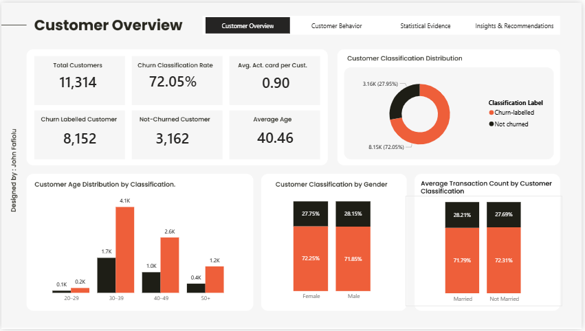

# Fintech Customer Behaviour & Classification Analysis

## Project Overview

This project investigates customer characteristics, transaction behaviour, card ownership and billing patterns across two customer classifications supplied in a fintech dataset.

Using SQL, Python, statistical methods and Power BI, I conducted an end-to-end analysis to identify patterns, test relationships and evaluate how customer attributes distinguish the supplied classifications.

Beyond descriptive analysis, the project applies hypothesis testing, effect size measurements and logistic regression to examine the strength of observed relationships and assess classification performance.

**Central Research Question:**

What customer characteristics and behavioural patterns distinguish customers across the two classifications supplied in the XYZ dataset?

## Analytical Approach

Question → Data Preparation → SQL Analysis → Statistical Investigation → Visualisation → Business Interpretation.

## Tools and Technologies

- **PostgreSQL:** Data storage, querying, classification, aggregation, and exploratory analysis.
- **Python:** Data analysis, statistical testing, correlation analysis, and logistic regression.
- **Google Colab:** Python analysis environment.
- **Microsoft Excel:** Initial data inspection, preparation, and quality assessment.
- **Power BI:** Interactive dashboard development and data visualisation.
- **GitHub:** Version control and project documentation.

## Dataset

- **Name:** Churn XYZ v1.0
- **Source:** [Zenodo](https://doi.org/10.5281/zenodo.17214115)
- **Records:** 11,314 customer records
- **Attributes:** 27 columns

The dataset contains customer demographics, card ownership, transaction activity, billing information, and a binary classification field.

The original dataset is not included in this repository. Please refer to the original source for access.

## Project Workflow

The project followed this analytical process:

1. **Data Inspection:** Examined the dataset structure, fields, and initial quality.
2. **Data Preparation:** Prepared the working data and documented missing values and inconsistencies.
3. **SQL Analysis:** Investigated customer classifications, demographics, transaction patterns, card ownership, billing, and usage.
4. **Statistical Analysis:** Applied descriptive statistics, hypothesis testing, and effect-size measures.
5. **Predictive Modelling:** Developed and evaluated logistic regression models using different transaction predictors.
6. **Documentation:** Recorded findings, data quality decisions, and analytical limitations.

## Power BI Dashboard

An interactive four-page Power BI report exploring customer classification, transaction behaviour, card ownership, billing patterns and statistical evidence.

The dashboard contains:

1. Customer Overview
2. Customer Behaviour
3. Statistical Evidence
4. Insights & Recommendations

**View the dashboard:**
- [Power BI Dashboard (.pbix)](dashboard/fintech_customer_churn.pbix)
- [PDF Report](dashboard/fintech_customer_churn.pdf)
- [Dashboard Documentation](dashboard/README.md)
## Key Findings

### 1. Customer Classification
72.05% of customers were labelled as churned, compared with 27.95% labelled as not churned.

The classification distribution was imbalanced, which is important when interpreting the statistical analysis and model performance.

### 2. Demographic Characteristics
Age showed a statistically significant association with customer classification, but the effect size was negligible (Cramér's V = 0.0288).

Gender and marital status showed no statistically significant associations.

**Business implication:** Demographic characteristics alone may offer limited value for distinguishing the two customer groups.

### 3. Transaction Behaviour
Customers labelled as churned had a substantially higher average transaction count (350.63) than customers labelled as not churned (106.43).

The difference was statistically significant, with a very strong effect size (rank-biserial correlation = 0.9041).

**Business implication:** Transaction activity deserves further investigation when studying differences between these customer classifications.

### 4. Card Ownership
Customers labelled as churned had an average of 1.12 active cards, compared with 0.33 among customers labelled as not churned.

The association between having zero active cards and customer classification was particularly strong (Cramér's V = 0.6589).

**Business implication:** Card ownership patterns may provide useful signals for understanding differences in customer engagement and product usage.

### 5. Classification Modelling
The annual transaction logistic regression model achieved:

- Accuracy: 95.87%
- ROC-AUC: 0.9877
- Not-churned F1-score: 0.93
- Churn-labelled F1-score: 0.97

These results describe performance on the held-out test set. They do not establish the model's ability to predict future customer churn.
## Repository Structure

```text
fintech-customer-behaviour-analysis/
│
├── README.md
│
├── sql/
│   ├── README.md
│   ├── 00_database_setup.sql
│   ├── 01_customer_classification.sql
│   ├── 02_demographic_analysis.sql
│   ├── 03_transaction_analysis.sql
│   ├── 04_card_ownership_analysis.sql
│   └── 05_billing_and_usage_analysis.sql
│
├── python/
│   ├── README.md
│   └── fintech_customer_analysis.ipynb
│
├── documentation/
│   ├── data_quality_assessment.md
│   ├── statistical_findings.md
│   └── limitations.md
│
└── dashboard/
    ├── README.md
    ├── fintech_customer_churn.pbix
    ├── fintech_customer_churn.pdf
    └── dashboard_overview.png
```
## Important Limitations

The dataset documentation does not establish the operational definition or timing of the churn classification.

Other limitations include incomplete date information, missing values, inconsistencies across related fields, and undocumented monetary units.

Consequently, the project treats the target variable as a supplied classification and interprets model performance cautiously.

Further details are available in the [Project Limitations](documentation/limitations.md) document.

## Author

**John Fafiolu**

Statistician | Data Analyst
